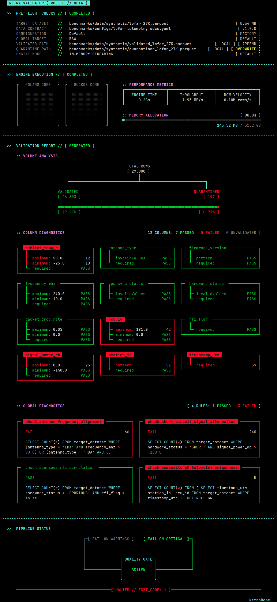
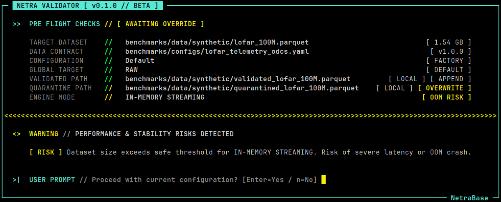
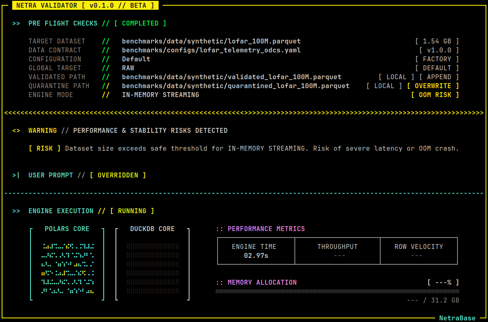
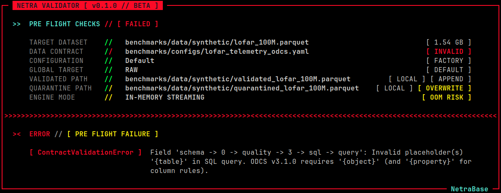

# Netra Validator

[](https://pypi.org/project/netra-validator/)
[](https://github.com/netrabase/netra-validator/actions)


### High-performance data validator built with Polars and DuckDB

Netra Validator is a high-performance, out-of-core data validation engine and pipeline firewall built with [Polars](https://github.com/pola-rs/polars) and [DuckDB](https://github.com/duckdb/duckdb). It validates datasets against **Open Data Contract Standard (ODCS v3.1.0)** YAML contracts (authored manually or auto-generated via [Netra Profiler](https://github.com/netrabase/netra-profiler)), separates clean and quarantined records, and produces a strictly typed audit report.

Traditional validation frameworks either load entire datasets into memory (crashing on large files) or require distributed clusters like Apache Spark. Netra Validator maximizes your [Data Quality Envelope](#data-quality-envelope) by combining Polars' multi-threaded streaming engine with DuckDB's out-of-core SQL capability, allowing you to validate large-scale datasets (e.g., 16.5 GB Parquet, 12 columns, 1 billion rows) locally on a single node such as a 32 GB laptop (see [Performance Benchmarks](#performance-benchmarks) below).

## Data Quality Envelope

The **Data Quality Envelope** is the maximum size and complexity of data your pipeline can profile, validate and quarantine within your hardware limits and compute budget.

As data volumes grow, teams are typically forced to either water down their quality checks (relying on rough samples or skipping expensive operations) or migrate to costly cloud instances or spin up multi-node distributed clusters just to run routine data quality checks. Netra Validator is designed to be a **value multiplier** for your existing hardware, allowing you to:

- **Stay Local Longer:** Run comprehensive quality checks on larger-than-memory datasets directly on your laptop or on-premise workstation without migrating to an HPC or cloud platform.
- **Scale Vertically, Not Horizontally:** Fully saturate the CPU cores and RAM of a single compute node, eliminating the operational and network shuffle overhead of distributed frameworks.
- **Control Compute & Energy Costs:** Avoid public cloud elasticity markups and reduce cluster energy consumption for predictable, recurring data health checks.

## Performance Benchmarks

> *Note: All scripts used to generate the synthetic datasets, run the benchmarks, and collect the results can be found in the [`benchmarks/`](https://github.com/netrabase/netra-validator/tree/main/benchmarks) directory.*

### Methodology

To evaluate Netra Validator under realistic scientific and industrial workloads, we designed a synthetic **LOFAR Radio Telescope Station Telemetry** dataset based on the system architecture and antenna anomaly taxonomy described in [*"Real-time station monitor and stationtest pipelines for LOFAR 2.0, Wang et al. (2025)"*](https://arxiv.org/abs/2503.02425):

- **Schema (12 Columns):** Models station receiver unit (RCU) telemetry combining 64-bit timestamps (`timestamp_utc`), categorical identifiers and state flags (`station_id`, `antenna_type`, `hardware_status`, `gps_sync_status`, `firmware_version`), 64-bit sensor floats (`frequency_mhz`, `signal_power_db`, `ambient_temp_c`, `packet_drop_rate`), 32-bit integers (`rcu_id`), and boolean flags (`rfi_flag`).
- **Contract Complexity:** Every benchmark run executes the [`lofar_telemetry_odcs.yaml`](https://github.com/netrabase/netra-validator/blob/main/benchmarks/configs/lofar_telemetry_odcs.yaml) contract end-to-end:
  1. **16 Row-Level Constraints:** Completeness (`required`) checks on all columns, numeric range bounds, categorical set membership (`invalidValues`), and **two regular expression checks** (`station_id` and `firmware_version`) evaluated across every row.
  2. **Physical Data Partitioning:** Compresses and writes **~99.15% of the dataset** to disk as clean records (Snappy Parquet) and **~0.85%** to disk as quarantined records.
  3. **4 Global SQL Rules:** Three cross-column anomaly checks (automatically fused into a single table scan) plus a **3-column composite Primary Key uniqueness check** (`GROUP BY timestamp_utc, station_id, rcu_id`) across the entire dataset.
- **Measurement Protocol:** In-memory scaling benchmarks execute **1 warmup run followed by 3 timed iterations**, reporting the **median** and run-to-run standard deviation (`± std`). Out-of-core (`spill_to_disk`) envelope runs execute a **single cold-start pass** (`--warmup 0 --iterations 1`) to measure maximum single-node capacity without cumulative thermal throttling or SSD write-cache saturation.
- **On-Disk vs. In-Memory Footprint:** All dataset sizes listed below reflect compressed Snappy Parquet files on disk. Because Parquet applies dictionary encoding (`RLE_DICTIONARY`) and Snappy compression to repeated categorical strings ([Apache Parquet Encodings](https://parquet.apache.org/docs/file-format/data-pages/encodings/)), the 16.5 GB, 1-billion-row file expands to **~85.8 GB in uncompressed Apache Arrow memory (~5.2x larger)** when materialized ([Apache Arrow Columnar Format](https://arrow.apache.org/docs/format/Columnar.html)).

### A. Single-Node Execution (10 Million to 1 Billion Rows)

All local benchmarks were executed on a standard consumer laptop:

- **CPU:** Intel(R) Core(TM) i7-10750H @ 2.60GHz (6 Physical / 12 Logical Cores)
- **RAM:** 31.16 GB (32 GB Physical)
- **OS:** Ubuntu 24.04.4 LTS (Linux 7.0)
- **Storage:** 512 GB NVMe SSD

#### 1. In-Memory Execution (10 Million to 500 Million Rows)

In default (in-memory) mode, all 12 logical CPU threads are utilized:

| Scale | Compressed Size (In-Memory Size) | Execution Time | Peak RAM |
| :--- | :--- | :--- | :--- |
| **10M** | 0.16 GB (~0.8 GB) | **3.49s** (±0.14s) | 2.19 GB |
| **50M** | 0.82 GB (~4.2 GB) | **18.43s** (±1.40s) | 6.91 GB |
| **100M** | 1.65 GB (~8.6 GB) | **32.11s** (±1.20s) | 10.59 GB |
| **200M** | 3.30 GB (~17.2 GB) | **65.44s (~1.1m)** (±3.21s) | 13.29 GB |
| **500M** | 8.25 GB (~42.9 GB) | **196.66s (~3.3m)** (±10.56s) | **27.58 GB** |

**Key Takeaways:**
- **Zero Startup Overhead:** At 10 million rows, Netra validates 16 column rules, writes partitioned Parquet files, and evaluates 4 global SQL rules in **3.49 seconds**, finishing before a distributed cluster can initialize.
- **Sub-Linear Memory Growth:** Increasing the dataset size by **50x** (from 10M to 500M rows) increases peak memory usage by only **12.6x** (`2.19 GB` to `27.58 GB`).
- **Validating Larger-Than-Memory Datasets Locally:** At 500 million rows, the dataset represents **~42.9 GB of uncompressed data**, exceeding the laptop's 32 GB of physical RAM. Netra validates and partitions the entire file in **3.3 minutes** within `27.58 GB` of RAM.

#### 2. Out-of-Core Envelope Expansion (500 Million to 1 Billion Rows)

On a 32 GB laptop, in-memory mode reaches its practical ceiling at 500 million rows (`27.58 GB` RAM), and larger workloads (`800M` and `1B` rows) exceed available system memory. Enabling `spill_to_disk` bounds memory consumption by processing data in smaller chunks (`50,000` rows) and spilling intermediate state to disk (`16 GB` engine memory limit, `4` active threads):

| Scale | Compressed Size (In-Memory Size) | Execution Time | Peak RAM |
| :--- | :--- | :--- | :--- |
| **500M** | 8.25 GB (~42.9 GB) | **229.91s (~3.8m)** | **16.91 GB** |
| **800M** | 13.20 GB (~68.6 GB) | **378.65s (~6.3m)** | **21.14 GB** |
| **1B** | 16.50 GB (~85.8 GB) | **506.21s (~8.4m)** | **28.79 GB** |
  
**Key Takeaways:**
- **10.67 GB RAM Reduction at `500M` Rows:** Compared to in-memory mode (`27.58 GB` in `196.66s`), enabling `spill_to_disk` at 500M rows cuts peak memory down to **`16.91 GB` (-38.7%)** for a modest `+33.25s` (+16.9%) trade-off in execution time, keeping roughly half of the laptop's RAM free for the OS and other applications.
- **2x Local Data Quality Envelope:** Out-of-core execution doubles the maximum dataset size the 32 GB laptop can handle, validating **1 Billion rows (~85.8 GB of uncompressed data)** and writing 991.5 million clean rows and 8.5 million quarantined rows to disk in **8.4 minutes**.

### B. Cloud Scale-Up (1 Billion to 3 Billion Rows)

In LOFAR 2.0, each station's Local Control Unit (LCU) is equipped with a **16-core / 32-thread processor and 64 GB of RAM** ([Wang et al., 2025, Sec. 5](https://arxiv.org/abs/2503.02425)). To benchmark Netra Validator on a similar hardware profile, we tested 1-billion to 3-billion-row datasets on an equivalent AWS EC2 compute node:

- **Instance:** AWS EC2 `c8id.8xlarge`
- **CPU:** Intel(R) Xeon(R) 6975P-C (16 Physical / 32 Logical vCPUs)
- **RAM:** 61.77 GB (64 GB Instance Class)
- **OS:** Ubuntu 24.04.1 LTS (Linux 7.0 AWS)
- **Storage:** Attached Nitro NVMe SSD

We evaluated both **In-Memory Mode** (`32` Polars threads / `32` DuckDB threads) and **Out-of-Core Mode** (`32` Polars threads / `8` DuckDB threads, `250,000`-row Polars batches, `32 GB` engine memory limit):

| Scale | Compressed Size (In-Memory Size) | In-Memory (Time / RAM) | Out-of-Core (Time / RAM<sup>†</sup>) |
| :--- | :--- | :--- | :--- |
| **1B** | 16.50 GB (~85.8 GB) | **198.47s (~3.3m)** / 56.05 GB | **278.64s (~4.6m)** / **34.01 GB** |
| **2B** | 33.00 GB (~171.6 GB) | *Exceeds 64 GB RAM* | **575.74s (~9.6m)** / **35.16 GB** |
| **3B** | 49.50 GB (~257.4 GB) | *Exceeds 64 GB RAM* | **858.14s (~14.3m)** / **61.41 GB** |

<sup>†</sup> *Note on Peak RAM (`peak_rss_mb`): `memory_limit_mb` (`16 GB` on Laptop, `32 GB` on EC2) caps the SQL engine's working buffer during disk spilling. Total process RAM reported by the OS (`getrusage`) can rise above this cap on massive datasets due to OS file caching and the index overhead required to track hundreds of millions of spilled records on disk.*

**Key Takeaways:**

**Key Takeaways:**

- **From Disk Spilling to In-Memory (`1B` Rows):** A 1-Billion-row workload that requires out-of-core disk spilling on a 32 GB laptop (`506.21s`) runs **entirely in memory in 3.3 minutes (`198.47s`)** on a 64 GB node.
- **3x Server Envelope Expansion (`1B` to `3B` Rows):** On a 64 GB machine, in-memory mode reaches its limit at 1 billion rows (`56.05 GB` RAM). Enabling `spill_to_disk` expands the single-node **Data Quality Envelope by 3x**, validating **2 billion rows** in **9.6 minutes** and **3 billion rows** (49.50 GB Parquet / ~257.4 GB uncompressed) in **14.3 minutes** without requiring a multi-node cluster.
- **Memory Behavior Across Scale (`1B` vs. `3B`):** At `1B` and `2B` rows, out-of-core mode holds total RAM steady at **`34.01 GB` – `35.16 GB`** (saving `22.04 GB` of RAM at `1B` compared to in-memory mode). At `3B` rows, the index overhead required to track 3 billion unique keys across temporary disk files pushes total process memory to **`61.41 GB`**, reaching the practical ceiling of a 64 GB node.

### C. Throughput & Execution Stability

As datasets grow from millions to billions of rows, Netra maintains steady processing speed in both execution modes without hitting a performance cliff:

#### 1. In-Memory Mode (3 Timed Iterations + 1 Warmup)

| Environment | Scale Range | Row Velocity (Median) | Disk Throughput (Median) | Run-to-Run Std Dev (`± std`) |
| :--- | :--- | :--- | :--- | :--- |
| **Laptop (32 GB)** | 10M – 500M | **2.54M – 3.11M rows/s** | 40.0 – 49.0 MB/s | ±0.14s (10M) to ±10.56s (500M) |
| **EC2 `c8id.8xlarge` (64 GB)** | 1B | **5.04M rows/s** | **79.3 MB/s** | **±2.13s** |

#### 2. Out-of-Core Mode (Single Cold-Start Pass)

| Environment | Scale Range | Row Velocity | Disk Throughput | Execution Time Scaling |
| :--- | :--- | :--- | :--- | :--- |
| **Laptop (32 GB)** | 500M – 1B | **1.98M – 2.17M rows/s** | 31.1 – 34.2 MB/s | `229.91s` (500M) ➔ `506.21s` (1B) |
| **EC2 `c8id.8xlarge` (64 GB)** | 1B – 3B | **3.47M – 3.59M rows/s** | **54.7 – 56.5 MB/s** | `278.64s` (1B) ➔ `858.14s` (3B) |

**Key Takeaways:**
- **Linear O(N) Scaling at Multi-Billion-Row Scale:** On the 32-vCPU server, doubling the out-of-core workload from **1B to 2B rows** increases execution time by **2.07x** (`278.64s` to `575.74s`), and tripling it to **3B rows** increases execution time by **3.08x** (`858.14s`).
- **No Throughput Degradation:** Processing velocity varies by less than **2.5%** across a 3x volume increase on the server (`3.59M rows/s` at 1B vs. `3.50M rows/s` at 3B) and less than **9%** across a 2x volume increase on the laptop (`2.17M rows/s` at 500M vs. `1.98M rows/s` at 1B).

## Features

- **Native ODCS v3.1.0 Support:** Validates datasets against any compliant [Open Data Contract Standard (v3.1.0)](https://bitol-io.github.io/open-data-contract-standard/v3.1.0/) YAML file—whether from an existing data catalog, written by hand, or generated automatically with [`netra-profiler`](https://github.com/netrabase/netra-profiler).
- **Automated Data Quarantine:** Automatically splits your input dataset into clean (`validated`) and corrupted (`quarantined`) Parquet files, ensuring bad data never enters downstream tables.
- **Single-Pass SQL Rule Batching:** Automatically combines multiple `SELECT COUNT(*) FROM {object} WHERE ...` contract rules into a single DuckDB table scan, with automatic per-rule fallback if a query contains a syntax error.
- **Configurable Global Target (`raw` vs. `validated`):** Choose whether Pass 2 Global/SQL rules evaluate the original raw dataset or only the clean rows that survived Pass 1 (`global_target`).
- **Out-of-Core Execution:** Process larger-than-memory datasets under strict RAM budgets using configurable disk spilling, micro-batch sizing, pre-flight free-space checks, and automatic thread clamping.
- **Container-Aware Thread Budgeting:** Automatically detects CPU limits via environment variables (`NETRA_POLARS_THREADS`, `NETRA_DUCKDB_THREADS`), Linux `cgroup` container quotas (Docker/Kubernetes), or physical core counts.
- **CI/CD Quality Gates:** Enforce strict pipeline governance with `--fail-on-critical` and `--fail-on-warnings` flags for GitHub Actions, GitLab CI, Airflow, and Dagster.
- **Rich CLI & Headless JSON Mode:** View validation summaries and rule diagnostics in the terminal, or pass `--json` for strictly typed JSON output in automated pipelines.

### Supported Validation Capabilities

| Validation Layer | Rule / Constraint | ODCS v3.1.0 Property |
| :--- | :--- | :--- |
| **Column / Row-Level** | Null / Completeness Check | `required: true` |
| | Numeric Lower & Upper Bounds | `logicalTypeOptions.minimum` / `maximum` |
| | String Length Bounds | `logicalTypeOptions.minLength` / `maxLength` |
| | Regular Expression Matching | `logicalTypeOptions.pattern` |
| | Allowed Categorical Values | `quality.metric: invalidValues` (`validValues`) |
| **Table / Global** | Primary Key Uniqueness | `primaryKey: true` |
| | Custom Column SQL Rules | `quality.type: sql` (`{object}`, `{property}`) |
| | Custom Table & Cross-Column SQL | `schema.quality.type: sql` (`{object}`) |
| | Mathematical SQL Boundaries | `mustBeEqual`, `mustBe`, `mustBeLessThan`, `mustBeGreaterThan` |

## Installation

We recommend installing Netra Validator with [uv](https://github.com/astral-sh/uv):

```bash
uv pip install netra-validator
```

Or with standard `pip`:

```bash
pip install netra-validator
```

## Quickstart

### 1. Command Line

Validate any dataset against an ODCS v3.1.0 YAML contract directly from your terminal:

```bash
# Optional: Auto-generate a baseline ODCS v3.1.0 contract with netra-profiler
netra profile dataset.parquet --json > profile.json
netra contract profile.json > contract.yaml

# Validate the dataset against the contract
netra validate dataset.parquet contract.yaml
```



<details>
<summary><b>More Screenshots</b></summary>
<br>

**Out-Of-Memory Risk Warning:**


**"Risky Execution" State:**


**Data Contract Error:**


</details>

#### CLI Options & Quality Gates

- `-o, --valid <path>`: Custom output path for rows that pass all row-level checks (defaults to `validated_<dataset>`).
- `-q, --quarantine <path>`: Custom output path for rows that fail one or more row-level checks (defaults to `quarantined_<dataset>`).
- `--global-target [raw|validated]`: Choose whether Pass 2 DuckDB SQL rules run against the `raw` input dataset (default) or the `validated` clean output from Pass 1.
- `-c, --config <path>`: Path to a custom `netra_config.yaml` file.
- `--fail-on-critical`: Enable the CI/CD Quality Gate and exit with code `1` if any `CRITICAL` anomalies (row quarantines or critical SQL failures) are detected.
- `--fail-on-warnings`: Enable the strictest CI/CD Quality Gate and exit with code `1` if **any** anomalies (`WARNING` or `CRITICAL`) are detected.
- `-y, --force`: Bypass interactive confirmation prompts when pre-flight hardware warnings are triggered.
- `--json`: Disable the interactive terminal UI and print the validation report as formatted JSON to `stdout`.
- `-V, --version`: Show the netra-validator version and exit.

### 2. Python API

Netra Validator provides a fully typed Python API for integration into Airflow, Dagster, Prefect, or custom data engineering services:

```python
from netra_validator.config import ValidatorConfig
from netra_validator.engine.validator import Validator

# 1. Configure quality gates and validator execution settings
# (Or load directly from disk via `ValidatorConfig.from_yaml("netra_config.yaml")`)
config = ValidatorConfig(
    {
        "pipeline": {
            "fail_on_critical": True,
            "fail_on_warnings": False,
        },
        "validator": {
            "global_target": "validated",  # Run Pass 2 SQL checks on clean Pass 1 output
            "spill_to_disk": {
                "enabled": True,
                "memory_limit_mb": 16384,  # 16 GB RAM ceiling for DuckDB Pass 2
                "chunk_size": 50_000,
                "temp_directory": "/tmp/netra_spill",
            },
        },
    }
)

# 2. Initialize and run the Validator
validator = Validator(
    contract_path="contracts/lofar_telemetry_odcs.yaml",
    dataset_path="data/lofar_telemetry.parquet",
    output_path="output/validated_telemetry.parquet",
    quarantine_path="output/quarantined_telemetry.parquet",
    config=config,
)

report = validator.run()

# 3. Inspect the strictly typed ValidationReport
summary = report["dataset"]
print(f"Total Evaluated:  {summary['total_rows_evaluated']:,}")
print(f"Valid Rows:       {summary['valid_rows']:,}")
print(f"Quarantined Rows: {summary['quarantined_rows']:,}")
print(f"Pipeline Status:  {report['pipeline_status']}")

# 4. Enforce CI/CD Quality Gate programmatically
pipeline_ctx = report["_meta"]["pipeline_context"]
if pipeline_ctx and pipeline_ctx["exit_code"] != 0:
    raise RuntimeError(
        f"Data contract validation failed: {pipeline_ctx['reason']}"
    )
```

### 3. Universal Configuration (`netra_config.yaml`)

Netra uses a centralized `netra_config.yaml` file to manage CI/CD quality gates and engine execution settings across the Netra suite. Global `pipeline` rules apply by default and can be overridden specifically for the validator under the `validator` block:

```yaml
# ---------------------------------------------------------
# PIPELINE: Global CI/CD Quality Gate Defaults
# ---------------------------------------------------------
pipeline:
  fail_on_critical: true       # Exit with code 1 if CRITICAL anomalies are detected
  fail_on_warnings: false      # Exit with code 1 if ANY anomalies (Warning or Critical) are detected

# ---------------------------------------------------------
# VALIDATOR: Contract Execution & Out-of-Core Settings
# ---------------------------------------------------------
validator:
  global_target: "raw"         # Evaluate Pass 2 SQL rules on "raw" input or "validated" output

  # Optional: Override global `pipeline` gates specifically for `netra validate`
  pipeline:
    fail_on_critical: true
    fail_on_warnings: true

  spill_to_disk:
    enabled: false             # Enable micro-batching and DuckDB disk spilling
    memory_limit_mb: 16384     # Maximum RAM ceiling for DuckDB Pass 2 (16 GB default)
    chunk_size: 50000          # Polars Pass 1 micro-batch row count when spilling is enabled
    temp_directory: "/tmp/netra_spill"
    min_spill_space_gb: 10     # Pre-flight disk free space requirement before starting a run
```

Netra Validator automatically looks for `netra_config.yaml` in your current working directory. You can also pass it explicitly via CLI flag or environment variable:

##### Using Command Line Flag

```bash
netra validate dataset.parquet contract.yaml --config path/to/custom_config.yaml
```

#### Environment Variable Overrides

To control CPU core allocation in shared or containerized environments, set the following environment variables before running Netra Validator:

```bash
export NETRA_CONFIG="/etc/netra/production_config.yaml"
export NETRA_POLARS_THREADS=8
export NETRA_DUCKDB_THREADS=8
netra validate dataset.parquet contract.yaml
```
